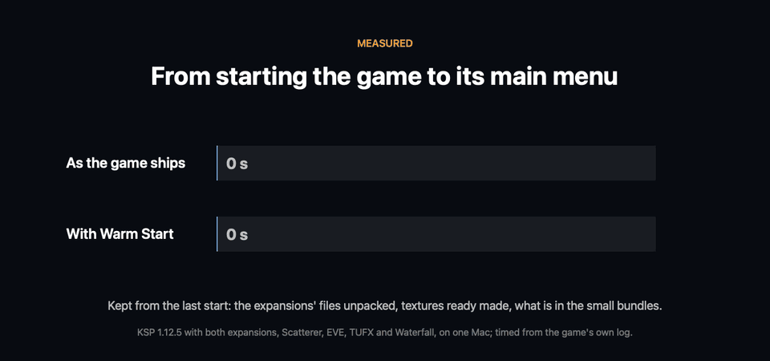

# Warm Start

Kerbal Space Program starts in less than half the time, because what it works out afresh at every start is kept from
the last one: the expansions' files unpacked, the textures converted, the small bundles' descriptions, the
parts' drag cubes.

For Kerbal Space Program 1.12.x. **Needs [Keystone](https://github.com/IshiakiZ/ksp-keystone)**, a separate download
([on SpaceDock](https://spacedock.info/mod/4665/Keystone)): this mod does not load without it.

## Install

Copy the `WarmStart` folder from the download into your KSP's `GameData`, beside `Keystone`. The first start after
that is as slow as ever, and a minute of work goes on in the background at its main menu. From the second start on
it is fast.

## Good to know

* **Measured:** to the main menu in 21 s instead of 55 on a Mac, and in 18 s instead of 47 on Windows 11.
* It takes about a gigabyte of disk (`GameData/WarmStart/PluginData`; deleting that folder loses only the time to make
  it again) and no memory.
* **After a mod is added, updated or taken out,** ModuleManager makes the game work out every part's drag cubes again
  (half a minute for a thousand parts). From 0.3.0 the cubes of every part that has not changed are handed back: 15 s
  of part compiling came down to 3 s here, with 480 parts.
* **With the Harmony mod** (not needed), the game's look-ups of models, pictures and sounds go by a table instead
  of a walk through every one: a tenth off a start with thousands of parts. That is the one part that changes the
  game's code; it checks itself against the game's own and has a switch. Without Harmony none of the game's code is
  changed.
* With **KSP Community Fixes** installed, which loads the game its own faster way, Warm Start does nothing: use one
  or the other.
* Its page in the Keystone window (the keystone button on the game's toolbar, or Alt-K; Option-K on a Mac) has a
  switch for each part, and says how long the start took and which mods the seconds went to.

## Works on

Windows 11 and Mac: measured (what 0.3.0 adds, on the Mac only so far). Linux: never run (it is plain C#, with
nothing of one system's in it).

**More:** [the long description](https://github.com/IshiakiZ/ksp-warm-start/wiki/The-long-description) (everything in full, and what was
measured on each system) and the rest of the [wiki](https://github.com/IshiakiZ/ksp-warm-start/wiki).

## Licence

[CC BY 4.0](LICENSE): use it, change it and pass it on as you like, as long as you credit Ishiaki and link back here.
